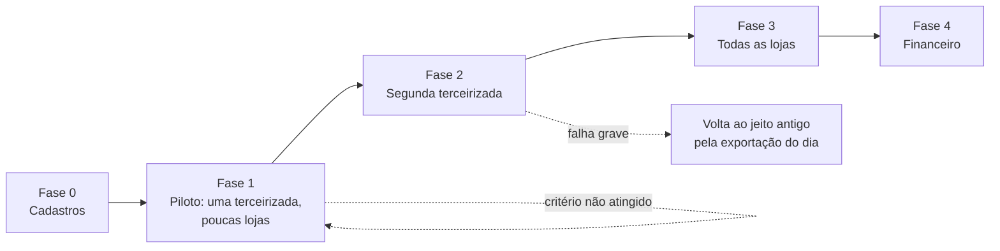

# SEALog — Adoção gradual

Como o SEALog entra na operação sem parar as entregas. A equipe da SEALog está acostumada com
planilha (Gargalos §9), os terceirizados têm pouca habilidade com tecnologia e a própria SEALog
pediu adaptação gradual (Encontro 1 [23:17]). Por isso a entrada é em fases, cada uma com critério
de avanço medido e com um caminho de volta (`DEC-SL-16`). Quanto tempo o jeito antigo convive com o
sistema é pergunta à SEALog (`Q-SL-14`).

---

## 1. Princípios

| Princípio | Na prática |
|---|---|
| **A loja não muda de canal** | Continua no mesmo número de WhatsApp. O que muda é o menu e o formulário (`DEC-SL-02`) |
| **A terceirizada começa como já trabalha** | Pode mandar planilha no começo, que o sistema traduz; o portal e a integração vêm depois (`DEC-SL-06`) |
| **Começar pequeno** | Uma terceirizada e poucas lojas no piloto; as que mais perguntam "cadê minha entrega?" primeiro |
| **Avançar por número, não por data** | Cada fase tem critério de saída medido no painel de adoção (`BL-SL-26`) |
| **Sempre ter volta** | A exportação diária da lista garante que a operação continua se o sistema cair |
| **Prazo para o paralelo** | Duas formas de pedir ao mesmo tempo cansam a equipe; a fase em paralelo tem duração máxima |

## 2. As fases

| Fase | Release | Quem entra | O que muda | Duração indicativa |
|---|---|---|---|---|
| **0 — Cadastros** | R1 em homologação | Coordenador, um atendente | Cadastro da equipe e das duas terceirizadas, com as regiões que cada uma atende; pedido de aprovação dos modelos de mensagem do WhatsApp; treino de até 1 hora por perfil | 1 a 2 semanas |
| **1 — Piloto** | R1 | Uma terceirizada e as lojas de uma região | As lojas da região pedem pelo menu do WhatsApp; os pedidos vão à terceirizada pelo sistema; ela retorna por planilha ou pelo portal, com o comprovante padrão. As outras lojas seguem como hoje | 2 semanas, no máximo 3 |
| **2 — Segunda terceirizada** | R1 | A outra terceirizada e as lojas da região dela | As duas regiões passam pelo sistema. A terceirizada que já está no piloto é convidada a sair da planilha para o portal ou a integração | 2 semanas |
| **3 — Todas as lojas** | R2 | Todas as lojas | Todo pedido entra pelo menu ou pela equipe; os avisos automáticos e o agente de ocorrências entram; o grupo interno de WhatsApp deixa de receber pedido | 2 a 4 semanas |
| **4 — Financeiro** | R3 | Financeiro | O primeiro fechamento de cobrança e de pagamento é feito no sistema e na planilha, e conferido linha a linha; os seguintes, só no sistema | Um ciclo de cobrança em paralelo |

As durações são indicativas: o que manda é o critério de avanço.

## 3. Critérios de avanço

O painel de adoção (`BL-SL-26`) mede cada critério a partir do próprio registro, sem pesquisa.

| Fase | Para avançar | Medida |
|---|---|---|
| 0 → 1 | Lojas e regiões cadastradas; modelos de mensagem aprovados; restauração de cópia testada | Lista de verificação do coordenador |
| 1 → 2 | 95% dos pedidos das lojas do piloto entrando pelo menu; toda entrega do piloto com retorno no mesmo dia; nenhum Entregue sem comprovante aceito | Canal de origem; hora do último retorno; retornos recusados |
| 2 → 3 | As duas terceirizadas retornando pelo sistema; duas semanas sem consultar planilha para saber de uma entrega | Painel de adoção |
| 3 → 4 | Nenhum chamado sem conclusão no fim do dia; "cadê minha entrega?" respondida pela lista de entregas | Painel de chamados; busca na lista de entregas |
| 4 → fim | Fechamento do sistema igual ao da planilha, ou diferenças explicadas | Conferência linha a linha |

## 4. Indicadores de adoção

| Indicador | O que mostra | Meta depois da fase 3 |
|---|---|---|
| Pedidos que entram pelo menu do WhatsApp | Se a loja adotou o formulário | A maior parte; o resto, pela equipe |
| Pedidos pendentes de dados | Se a validação funciona | Bem menos que o 1 em 5 de hoje (Enunciado §2) |
| Retornos por integração, portal e planilha | Se a terceirizada está saindo da planilha | Tendência de queda da planilha |
| Retornos recusados por comprovante incompleto | Se o padrão foi entendido | Caindo semana a semana |
| Entregas sem retorno no prazo | Se a terceirizada informa na hora | Zero no fim do dia |
| Chamados concluídos no mesmo dia | Se o painel substituiu o grupo | 100% até 19h |

## 5. Riscos de adoção

| Risco | Sinal | Resposta |
|---|---|---|
| Loja continua mandando texto livre | Muitos pedidos registrados pela equipe | A equipe registra, e a loja recebe o formulário para completar; conversa com as lojas que mais mandam texto |
| Terceirizada não sai da planilha | Planilha como único canal depois da fase 2 | Planilha continua aceita; o pagamento só considera entrega com comprovante aceito, o que vale em qualquer canal (`RN-SL-048`) |
| Comprovante incompleto | Muitos Entregues recusados | Reunião com a terceirizada mostrando o padrão; portal que não envia sem a foto |
| Equipe mantém a planilha "por garantia" | Planilha editada depois da fase 3 | Exportação diária automática, que torna a planilha manual desnecessária |
| Sistema cai no meio do dia | Monitor em alerta | A equipe usa a exportação do dia; a terceirizada guarda os retornos e reenvia, sem duplicar (`RN-SL-033`) |

## 6. Adaptação por funcionalidade

Algumas funcionalidades entram ligadas por chave de configuração, para que a SEALog as ative no
seu ritmo, sem nova versão: o menu do WhatsApp por loja, o aviso automático de problema, o agente
de ocorrências e o aviso em lote. Assim a fase 3 pode abrir para algumas lojas antes de todas.
