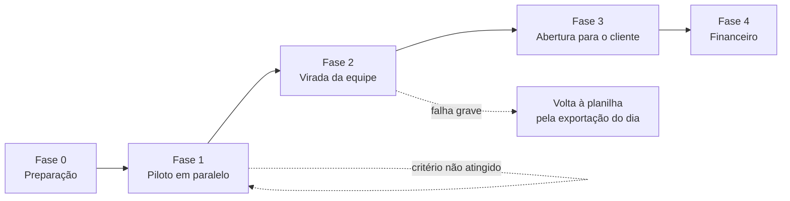

# SEALog — Adoção gradual

Como o SEALog entra na operação sem parar as entregas. O resumo dos gargalos diz que o risco
principal é a adoção: a equipe está acostumada com planilha, e os clientes pequenos não vão
mudar de canal (Gargalos §9). Por isso a entrada é em fases, cada uma com critério de avanço
medido e com um caminho de volta (`DEC-SL-16`). Quanto tempo planilha e sistema convivem é pergunta à SEALog (`Q-SL-14`).

---

## 1. Princípios

| Princípio | Na prática |
|---|---|
| **O cliente não muda de canal** | Continua no WhatsApp e no Instagram. O que muda é que recebe um link na mesma conversa (`DEC-SL-03`) |
| **A planilha não some, muda de papel** | Durante o piloto ela é a cópia de segurança; depois da virada, só se exporta para ela (`DEC-SL-08`) |
| **Começar pequeno, com quem quer** | O piloto roda com os motoristas e o analista mais dispostos, que depois treinam os colegas |
| **Avançar por número, não por data** | Cada fase tem critério de saída medido no painel de adoção (`BL-SL-25`) |
| **Sempre ter volta** | Até a virada a planilha está em dia; depois dela, a exportação diária garante que a operação continua se o sistema cair |
| **Prazo para o paralelo** | Registrar em dois lugares cansa. A fase em paralelo tem duração máxima, para não virar o novo normal |

## 2. As fases

| Fase | Release | Quem entra | O que muda | Duração indicativa |
|---|---|---|---|---|
| **0 — Preparação** | R1 em homologação | Coordenador, um analista, um atendente | Cadastro da equipe e dos clientes ativos; impressora de etiquetas instalada; treino de até 1 hora por perfil; pedido de aprovação dos modelos de WhatsApp | 1 a 2 semanas |
| **1 — Piloto em paralelo** | R1 | 2 ou 3 motoristas, uma região de bairros próximos, os pedidos dessa região | Pedidos da região registrados no sistema, com etiqueta impressa e rota publicada; os motoristas registram cada parada no aplicativo. A planilha continua em dia, como cópia | 2 semanas, no máximo 3 |
| **2 — Virada da equipe** | R1 | Todos os motoristas e toda a equipe | Todo pedido entra no sistema. A planilha deixa de ser editada e passa a ser exportada uma vez por dia. O grupo de WhatsApp dos motoristas deixa de receber roteiro e foto | 2 semanas até estabilizar |
| **3 — Abertura para o cliente** | R2 | Todos os clientes | O link de pedido passa a ser enviado a quem pede por mensagem; o link de rastreio e os avisos automáticos saem sozinhos; o painel de exceções substitui o grupo | 2 a 4 semanas |
| **4 — Financeiro** | R3 | Financeiro | O primeiro fechamento é feito no sistema e na planilha, e conferido linha a linha; os seguintes, só no sistema | Um ciclo de cobrança em paralelo |

As durações são indicativas: o que manda é o critério de avanço.

## 3. Critérios de avanço

O painel de adoção (`BL-SL-25`) mede cada critério a partir do próprio registro, sem pesquisa.

| Fase | Para avançar | Medida |
|---|---|---|
| 0 → 1 | Equipe treinada, clientes ativos cadastrados, restauração de cópia de segurança testada | Lista de verificação do coordenador |
| 1 → 2 | 95% das paradas do piloto registradas na hora do fato; nenhuma entrega do piloto perdida ou duplicada; motoristas do piloto preferem o aplicativo ao grupo | Hora do fato comparada à hora da parada; conferência com a planilha paralela; conversa com os motoristas |
| 2 → 3 | Duas semanas sem consultar a planilha para saber de uma entrega; "cadê minha entrega?" respondida em menos de 1 minuto (`RNF-SL-05`) | Painel de adoção; tempo medido no atendimento |
| 3 → 4 | Metade dos clientes que pedem por mensagem usando o link; nenhuma ocorrência sem decisão no fim do dia | Canal de origem dos pedidos (`RN-SL-005`); painel de exceções |
| 4 → fim | Fechamento do sistema igual ao da planilha, ou diferenças explicadas | Conferência linha a linha |

## 4. Indicadores de adoção

| Indicador | O que mostra | Meta depois da fase 3 |
|---|---|---|
| Pedidos registrados no sistema | Se a planilha ainda recebe pedido por fora | 100% |
| Pedidos que chegam pelo link do cliente | Se o cliente adotou o autoatendimento | Metade dos pedidos por mensagem |
| Pedidos pendentes de dados | Se a validação na entrada funciona | Menos que os cerca de 1 em 5 de hoje (Gargalos §1) |
| Paradas registradas na hora do fato | Se o motorista registra na rua ou no fim do dia | 95% |
| Tempo até responder "cadê minha entrega?" | O ganho que o cliente sente | Menos de 1 minuto, contra 20 minutos a 2 horas hoje (Gargalos §4) |
| Ocorrências decididas no mesmo dia | Se o painel substituiu o grupo | 100% até 19h |

## 5. Riscos de adoção

| Risco | Sinal | Resposta |
|---|---|---|
| Motorista volta a mandar foto no grupo | Paradas registradas no fim do dia, em lote | Conversa individual; conferir sinal e celular; o comprovante só vale pelo aplicativo |
| Equipe mantém a planilha "por garantia" | Planilha editada depois da virada | Exportação diária automática que torna a planilha manual desnecessária |
| Cliente não abre o link | Pedidos por link abaixo da meta | O atendente continua registrando pela conversa; o link é opção, não obrigação |
| Sistema cai no meio do dia | Monitor do rastreio em alerta | Aplicativo do motorista segue gravando sem conexão; equipe usa a exportação do dia |
| Paralelo que não termina | Fase 1 passa de 3 semanas | O coordenador decide avançar ou ajustar; não se estende sem decisão |

## 6. Adaptação por funcionalidade

Algumas funcionalidades entram ligadas por chave de configuração, para que a SEALog as ative no
seu ritmo, sem nova versão: o envio automático do link de rastreio, o aviso automático de
ocorrência, a importação de planilha e o link de pedido para o cliente. Assim a fase 3 pode
abrir para alguns clientes antes de todos — começando pelos que mais perguntam "cadê minha
entrega?".
