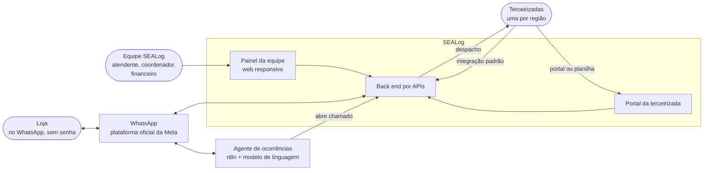
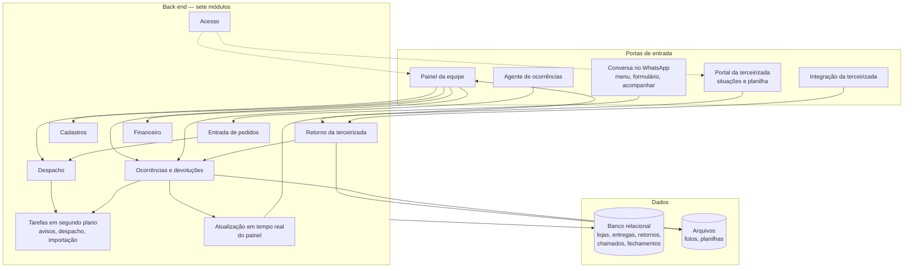
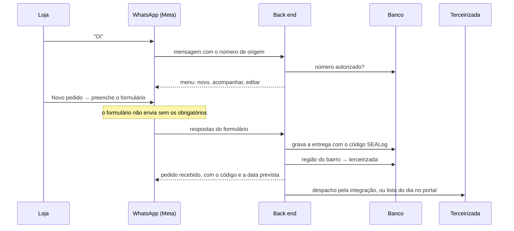
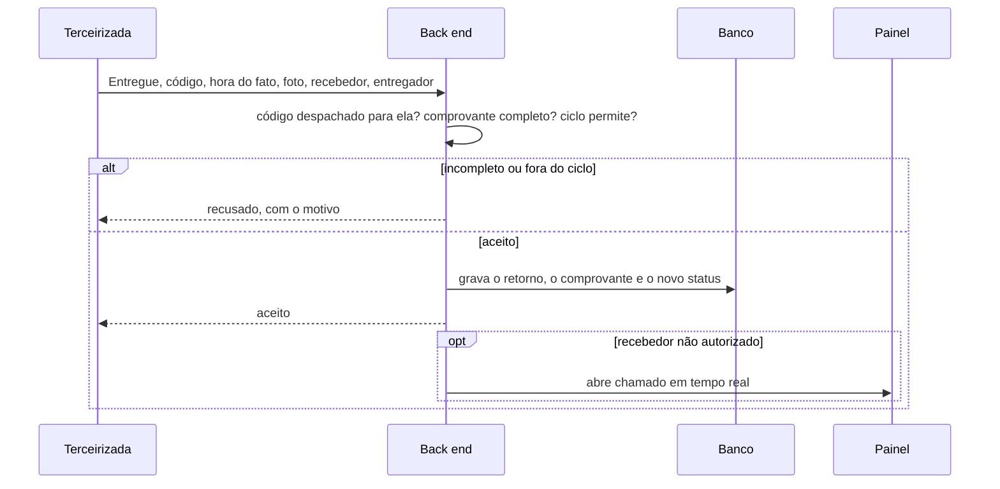
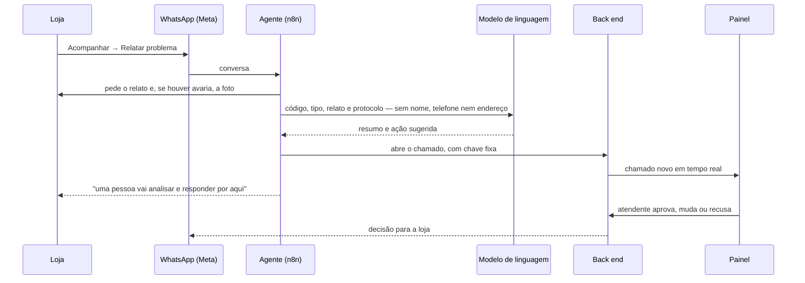

# SEALog — Arquitetura do sistema

A arquitetura proposta para o SEALog depois da terceirização. Responde a três perguntas: quais são
as partes, como conversam, e por que esta forma e não outra. Os requisitos não dependem dela
(`DEC-SL-19`); a escolha final de servidor e de banco gerenciado está **a confirmar pela equipe**
de back end e infraestrutura.

---

## 1. Princípios

| Princípio | O que obriga na arquitetura | Decisão |
|---|---|---|
| Um registro, uma verdade | Um banco só; nenhuma porta guarda cópia editável da entrega | `DEC-SL-01` |
| Tudo por API | WhatsApp, painel, portal, terceirizada e agente usam as mesmas APIs do back end | `DEC-SL-12` |
| Ninguém muda de canal à força | A loja fica no WhatsApp; a terceirizada escolhe integração, portal ou planilha | `DEC-SL-02`, `DEC-SL-06` |
| IA sugere, pessoa decide | O agente só abre chamado; a decisão é gravada por uma pessoa no painel | `DEC-SL-10` |
| Pequeno para operar | Serviços gerenciados no lugar de servidores próprios onde der; um back end só | `DEC-SL-12`, `DEC-SL-17` |

## 2. Visão de contexto

Quem usa o SEALog e com quem ele conversa.

## 3. Componentes

| Componente | Responsabilidade | Requisitos que atende |
|---|---|---|
| Conversa no WhatsApp | Menu de três opções, formulário do pedido e da edição, acompanhamento, avisos; tudo pela plataforma oficial | `RF-SL-01` a `RF-SL-04`, `RF-SL-20`, `RNF-SL-01` |
| Painel da equipe | Lista de entregas, cadastros, regiões, chamados, devoluções, afetados, fechamentos, exportação; web responsivo | `RF-SL-05` a `RF-SL-10`, `RF-SL-18`, `RF-SL-19`, `RF-SL-21` a `RF-SL-24`, `RNF-SL-03` |
| Portal da terceirizada | Lista do dia, situação de cada entrega com foto, envio de planilha | `RF-SL-11`, `RF-SL-14`, `RF-SL-15`, `RNF-SL-02` |
| Integração da terceirizada | Recebe o despacho e as alterações; devolve as situações e o comprovante; chave por terceirizada | `RF-SL-11` a `RF-SL-13`, `RNF-SL-05`, `RNF-SL-12`, `RNF-SL-15` |
| Agente de ocorrências | Conversa com a loja, classifica, colhe relato e fotos, compara com o protocolo e abre o chamado com a sugestão | `RF-SL-17`, `RNF-SL-13` |
| Back end | Os sete módulos, cada um dono das suas tabelas; aplica ciclo de status, permissões e histórico | `RNF-SL-11`, `RNF-SL-14`, `RNF-SL-17`, `RNF-SL-19` |
| Tarefas em segundo plano | Envio de avisos com nova tentativa, despacho à integração, tradução de planilha, exportações | `RF-SL-12`, `RF-SL-15`, `RF-SL-20`, `RNF-SL-20` |
| Atualização em tempo real | Leva o chamado novo ao painel sem recarregar | `RNF-SL-09` |
| Banco relacional | O registro único | `DEC-SL-01`, `DEC-SL-12` |
| Arquivos | Fotos de comprovante e de avaria, planilhas recebidas e exportadas | `RF-SL-16`, `RNF-SL-06` |

## 4. Fluxos que a arquitetura precisa garantir

### 4.1 Pedido pelo WhatsApp

### 4.2 Retorno com comprovante

Retorno repetido — mesmo código, mesma situação, mesma hora do fato — é respondido como aceito e
não grava de novo (`RN-SL-033`). A foto é copiada para o armazenamento do SEALog; o sistema não
depende de a terceirizada mantê-la.

### 4.3 Ocorrência com o agente

## 5. Segurança

| Ameaça | Proteção |
|---|---|
| Alguém pede em nome de uma loja | Só número autorizado abre o menu (`RN-SL-003`) |
| Uma terceirizada lê ou altera entrega da outra | Chave e usuário por terceirizada; ela só vê e altera o que foi despachado para ela (`RN-SL-053`) |
| Chamada falsa abrindo chamados | A rota de chamados aceita só a chave fixa do agente; limite de chamadas por minuto em toda integração (`RNF-SL-12`) |
| Um perfil faz o que não pode chamando a API direto | Permissão conferida no back end, não só escondida na tela (`RNF-SL-11`) |
| Tentativa repetida de senha | Bloqueio depois de cinco tentativas seguidas sem sucesso (`RNF-SL-10`) |
| Dado pessoal enviado ao modelo de linguagem | O agente envia só código, tipo, relato e fotos; o back end junta o contato ao gravar (`RN-SL-038`) |
| Alteração sem rastro | O histórico é gravado na mesma operação que altera, e ninguém o edita (`RNF-SL-14`) |
| Vazamento de fotos | Fotos acessadas só pelo painel, por perfil, com endereço temporário; prazo de guarda em `Q-SL-16` |

## 6. Stack proposta

| Camada | Proposta | Por quê | Situação |
|---|---|---|---|
| Canal da loja | Plataforma oficial do WhatsApp da Meta, com formulários do WhatsApp | A loja já está lá; a via oficial não arrisca o número (`DEC-SL-15`) | Proposta |
| Back end | Serviço único, organizado pelos sete módulos, expondo APIs REST e atualização em tempo real por websocket | Arquitetura baseada em APIs, decidida pela equipe (`DEC-SL-12`) | Linguagem e servidor a confirmar pela equipe |
| Banco | PostgreSQL | O dado é relacional e o histórico precisa de integridade | Onde hospedar a confirmar pela equipe |
| Arquivos | Armazenamento de objetos para fotos e planilhas | A foto é o dado que mais cresce | A confirmar pela equipe |
| Painel e portal | Aplicação web responsiva, um código para os dois | Abre no celular e no computador sem instalar nada (`DEC-SL-13`) | Proposta |
| Agente de ocorrências | n8n Cloud com o nó de agente de IA e o modelo GPT-4o | Orquestração pronta para WhatsApp e HTTP; modelo com bom raciocínio sobre regras (`DEC-SL-14`) | Proposta |

A infraestrutura e os custos estão em [`infraestrutura-e-custos.md`](infraestrutura-e-custos.md);
como ela cresce, em [`escalabilidade.md`](escalabilidade.md).
