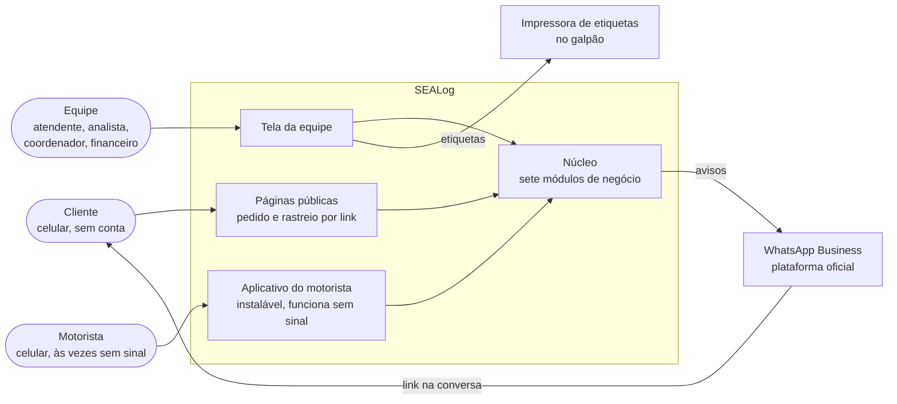
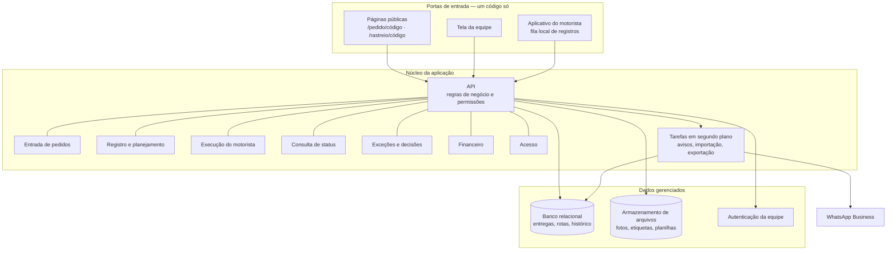
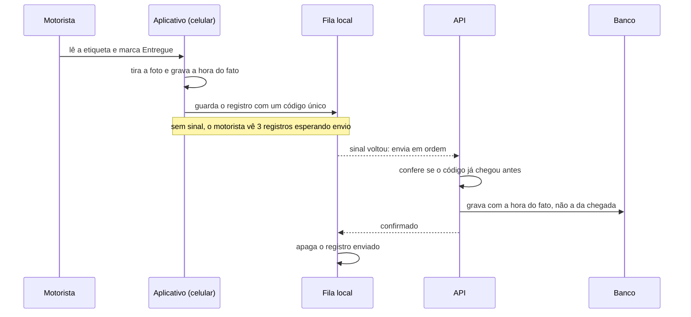

# SEALog — Arquitetura do sistema

A arquitetura proposta para o SEALog. É **proposta**: a stack não foi definida pela SEALog
(`Q-SL-01`), e os requisitos não dependem dela (`DEC-SL-10`). O que está aqui responde a três
perguntas: quais são as partes, como conversam, e por que esta forma e não outra.

---

## 1. Princípios

| Princípio | O que obriga na arquitetura | Decisão |
|---|---|---|
| Um registro, uma verdade | Um banco só, e nenhuma parte do sistema guarda cópia editável da entrega | `DEC-SL-01` |
| Registrar onde o fato acontece | O aplicativo do motorista funciona sem sinal, e o cliente acessa por link | `DEC-SL-03`, `DEC-SL-13` |
| Pequeno para operar | Serviços gerenciados no lugar de servidores; um código só | `DEC-SL-12`, `DEC-SL-15` |
| Crescer quando precisar | Módulos separados por dentro, que podem virar serviços se um gatilho pedir | `DEC-SL-17` |

## 2. Visão de contexto

Quem usa o SEALog e com quem ele conversa.



## 3. Componentes



| Componente | Responsabilidade | Requisitos que atende |
|---|---|---|
| Páginas públicas | Formulário de pedido e de complemento, e rastreio. Acessadas por link com código impossível de adivinhar, sem login | `RF-SL-02`, `RF-SL-04`, `RF-SL-18`, `RNF-SL-01`, `RNF-SL-07` |
| Tela da equipe | Lista de entregas, pendências, etiquetas, galpão, rotas, painel de exceções, fechamento, exportação | `RF-SL-01`, `RF-SL-07` a `RF-SL-12`, `RF-SL-19` a `RF-SL-26` |
| Aplicativo do motorista | Roteiro do dia, leitura da etiqueta pela câmera, foto, ocorrência; guarda tudo no aparelho e envia quando há sinal | `RF-SL-13` a `RF-SL-17`, `RNF-SL-02`, `RNF-SL-03`, `RNF-SL-11` |
| API | Única porta para o banco. Aplica o ciclo de status, as permissões por perfil e o histórico de alterações | `RNF-SL-08`, `RNF-SL-09`, `RNF-SL-13` |
| Módulos de negócio | Os sete módulos da documentação, separados por dentro da mesma aplicação, cada um dono das suas tabelas | Inventário de módulos do `00` do SEALog |
| Tarefas em segundo plano | Envio dos avisos com nova tentativa, importação de planilha, geração de exportações e de etiquetas | `RF-SL-03`, `RF-SL-22`, `RF-SL-23`, `RF-SL-25`, `RNF-SL-19` |
| Banco relacional | O registro único: clientes, entregas, volumes, rotas, paradas, ocorrências, avisos, fechamentos, histórico | `DEC-SL-01`, `DEC-SL-15` |
| Armazenamento de arquivos | Fotos de comprovante, comprimidas no celular; planilhas importadas e exportadas | `RF-SL-15`, `RNF-SL-17` |
| Autenticação | Usuário e senha da equipe, sessão longa do motorista durante o dia | `RF-SL-26`, `RNF-SL-08` |

## 4. Fluxos que a arquitetura precisa garantir

### 4.1 Registro sem sinal

O ponto mais delicado: o registro nasce no celular, às vezes sem conexão, e precisa chegar uma
vez só, com a hora real do fato (`RN-SL-030`).



O código único de cada registro faz com que um reenvio, depois de uma conexão que caiu no meio,
não gere uma segunda parada. A foto sobe separada do registro, e o registro vale mesmo antes de
a foto terminar de subir.

### 4.2 Ocorrência e aviso ao cliente

```mermaid
sequenceDiagram
  participant M as Motorista
  participant S as API
  participant P as Painel de exceções
  participant J as Tarefa de avisos
  participant W as WhatsApp Business
  participant C as Cliente

  M->>S: Não entregue, motivo destinatário ausente
  S->>P: abre a ocorrência
  S->>J: agenda o aviso
  J->>W: envia o modelo de mensagem com o link de rastreio
  W-->>C: mensagem na conversa de sempre
  W-->>J: resultado do envio
  alt falhou
    J->>P: aviso com falha, para reenvio
  end
  Note over P: o coordenador decide o destino;<br/>a decisão gera o segundo aviso
```

## 5. Segurança

| Ameaça | Proteção |
|---|---|
| Alguém troca o código do link e vê a entrega de outro | Código longo e aleatório, não sequencial; a página pública mostra só a entrega do código e nunca o telefone do motorista (`RNF-SL-07`) |
| Um perfil faz o que não pode chamando a API direto | Permissão conferida na API e no banco, não só escondida na tela (`RNF-SL-08`) |
| Alteração sem rastro | A API grava o histórico na mesma operação que altera; ninguém edita o histórico (`RNF-SL-09`) |
| Vazamento de dados pessoais | Acesso por perfil, conexão cifrada, fotos acessadas só por endereço temporário; prazo de guarda definido com a SEALog (`RNF-SL-10`) |
| Celular do motorista perdido | Sessão encerrável pelo coordenador; o aparelho guarda só o roteiro do dia |

## 6. Stack proposta

| Camada | Proposta | Por quê | Alternativa equivalente |
|---|---|---|---|
| Tela da equipe, páginas públicas e aplicativo do motorista | React com TypeScript, num só projeto, com o aplicativo do motorista instalável e funcionando sem sinal | Um código para as três portas (`RNF-SL-16`); o mesmo conjunto que a equipe usa neste repositório | Angular ou Vue |
| API e tarefas | Node.js com TypeScript, junto da aplicação | Mesma linguagem do front; equipe pequena | .NET ou Python |
| Banco, autenticação e arquivos | Supabase: PostgreSQL gerenciado, autenticação e armazenamento de arquivos | Um fornecedor para os três, com cópia de segurança diária e plano que cresce (`DEC-SL-15`) | PostgreSQL na AWS ou no Google Cloud |
| Hospedagem | Vercel | Publicação automática a cada versão, rede de entrega de conteúdo inclusa | Netlify, Cloudflare Pages |
| Avisos | Plataforma oficial do WhatsApp Business (Meta) | O cliente já está no WhatsApp; a via oficial não arrisca o número (`DEC-SL-14`) | Um provedor parceiro da Meta |
| Leitura de etiqueta | Leitura de código pela câmera, no navegador | Dispensa leitor dedicado | Leitor de código em bluetooth no galpão |
| Monitoramento | Registro de erros do aplicativo e monitor externo do rastreio | Falha percebida antes da reclamação (`RNF-SL-19`) | — |

A infraestrutura, os ambientes e os custos dessa stack estão em
[`infraestrutura-e-custos.md`](infraestrutura-e-custos.md); como ela cresce, em
[`escalabilidade.md`](escalabilidade.md).
