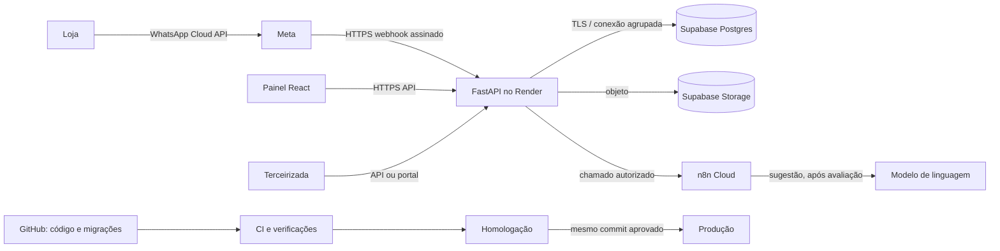

# SEALog — Plano DevOps

O plano adota entregas pequenas, automação de verificações, ambientes separados, segurança incorporada ao ciclo de desenvolvimento e operação guiada por sinais do serviço. As escolhas evitam infraestrutura maior do que a escala prevista no projeto.

## 1. Arquitetura de entrega

| Componente | Planejamento | Motivo no contexto SEALog |
|---|---|---|
| Back end | Um serviço modular em FastAPI no Render | Um ponto de validação para WhatsApp, painel, terceirizadas e agente; reduz operação e mantém as regras no servidor |
| Banco | PostgreSQL gerenciado no Supabase | Os registros de entrega, histórico e cobrança são relacionais; backups e operação gerenciada reduzem trabalho de infraestrutura |
| Arquivos | Supabase Storage para fotos e planilhas | Mantém referências de arquivos junto ao sistema; exige cópia independente porque backup do banco não inclui objetos |
| Painel | React como site estático servido por CDN | O painel é uma aplicação web responsiva e não precisa de servidor próprio para renderização |
| Tarefas assíncronas | Fila persistida no banco no primeiro patamar; separar worker apenas se métricas mostrarem necessidade | Evita serviço adicional antes de haver volume que justifique |
| Agente | n8n Cloud como orquestração fora do caminho crítico do webhook | Falha do agente não pode impedir pedido, registro de entrega ou abertura manual de chamado |
| Publicação | GitHub Actions para verificações e promoção controlada | Mantém o processo repetível, revisável e ligado a um commit específico |

## 2. Ambientes e configuração

Manter desenvolvimento local, homologação e produção como contextos distintos. Homologação e produção usam projetos/bancos, buckets, credenciais e configurações separados. Homologação usa dados sintéticos; cópias de dados de produção não são usadas como massa de teste.

O código e as migrações são versionados. Segredos e valores específicos de ambiente ficam em armazenamento de configuração protegido, fora do Git e dos logs. O painel web não recebe a chave de serviço do banco. Cada integração recebe apenas a credencial e as permissões que precisa.

O projeto já propõe Render, Supabase, n8n Cloud e Meta. A região do banco e do back end deve ser escolhida considerando latência e transferência internacional de dados; a arquitetura atual deixa essa escolha sujeita à validação de privacidade e negócio.

## 3. Integração e promoção de mudanças

### Fluxo proposto

1. Alterações pequenas entram por pull request e revisão de código.
2. A integração contínua executa verificações automatizadas antes da homologação.
3. O candidato é identificado por SHA e promovido à homologação.
4. A homologação valida o comportamento integrado, as migrações e fluxos críticos.
5. Produção recebe o mesmo SHA que passou em homologação, com configuração própria e uma liberação controlada.

O uso de ambientes do GitHub pode restringir branches, separar segredos e exigir aprovação para o ambiente de produção. A disponibilidade de certas proteções depende do plano e da visibilidade do repositório; essa condição deve ser confirmada ao configurar o workflow. [GitHub — deployment environments](https://docs.github.com/en/actions/concepts/workflows-and-actions/deployment-environments)

### Verificações da pipeline

| Etapa | Cobertura planejada | Risco que reduz |
|---|---|---|
| Qualidade do código | Lint, tipos e testes unitários do back end e painel | Erros simples e regressões localizadas |
| Migrações | Aplicação em banco vazio e execução repetida | Banco que não inicia do zero ou mudança não repetível |
| Webhook | Teste HTTP com corpo cru assinado e corpo alterado; deduplicação por `wamid` | Falsificação, alteração do payload e entrega duplicada |
| Integrações | Contratos de API, respostas de erro e processamento de filas | Mudança incompatível entre componentes |
| Segurança | Análise de dependências e vulnerabilidades no código/build | Componentes vulneráveis antes da publicação |
| Evidência da release | SHA, resultados e relatório da pipeline | Perda de rastreabilidade do que está publicado |

As verificações aplicam o princípio de segurança desde o desenvolvimento descrito pelo [NIST SSDF](https://csrc.nist.gov/pubs/sp/800/218/final). A pipeline começa com checagens proporcionais ao serviço e pode crescer conforme surgirem riscos ou incidentes observados.

### Mudanças de banco e reversão

Usar migrações versionadas e compatíveis com a versão anterior do back end. Preferir mudanças aditivas: criar nova estrutura, migrar leituras/escritas e remover a estrutura antiga em release posterior. Evitar uma publicação que exija que aplicação e banco mudem simultaneamente.

Se uma versão falhar, o plano é retornar ao commit anterior já publicado, desde que as migrações mantenham compatibilidade. Mudanças destrutivas ficam fora de uma release comum até haver estratégia de restauração testada. O Render faz health checks e mantém a versão anterior ativa quando a nova versão falha nas verificações do deploy. [Render — health checks](https://render.com/docs/health-checks), [Render — rollbacks](https://render.com/docs/rollbacks)

## 4. Segurança de entrega

- Proteger a branch principal e exigir revisão antes de integrar mudanças.
- Guardar segredos por ambiente, com acesso mínimo e rotação quando necessário.
- Manter a chave de serviço Supabase somente no back end; nunca no painel ou bundle do navegador.
- Validar `X-Hub-Signature-256` sobre os bytes originais do webhook antes de interpretar o JSON; gravar o `wamid` com restrição única antes de responder sucesso.
- Tratar mensagem, planilha e saída de modelo como entrada não confiável; validar esquema e limites no back end.
- Não registrar segredos, corpo de mensagens, fotos ou dados pessoais em logs técnicos.
- Executar análise de dependências e registrar a procedência do código e do artefato publicado.

Essas práticas adaptam o NIST SSDF ao porte da solução: proteger o ambiente de desenvolvimento, verificar componentes externos, testar software antes de publicar e registrar vulnerabilidades e correções. [NIST SSDF](https://csrc.nist.gov/projects/SSDF)

## 5. Confiabilidade e observabilidade

Observar o serviço por quatro grupos de sinais: latência, volume, erros e saturação. Separar o tempo até reconhecer e persistir o webhook do tempo para baixar mídia e processar planilha; os processos assíncronos não devem ocultar uma resposta lenta do webhook.

| Sinal | Medida útil ao SEALog |
|---|---|
| Latência | Tempo de confirmação HTTP do webhook; duração da mídia; duração da planilha; tempo das APIs do painel |
| Volume | Eventos recebidos, chamadas por integração e tarefas por fila |
| Erros | Falhas de assinatura, banco, envio, processamento de mídia/planilha e respostas externas |
| Saturação | CPU e memória do Render, conexões do banco e idade/profundidade das filas |

A meta de engenharia do reconhecimento do webhook é p95 inferior a 1 segundo; p95 acima de 2 segundos gera aviso informativo. Alertas que interrompem uma pessoa devem indicar falha acionável e visível ao usuário, como webhook indisponível; alertas de lentidão ou tendência ficam no painel. Essa separação segue a orientação do [Google SRE](https://sre.google/sre-book/monitoring-distributed-systems/) para evitar alertas sem ação imediata.

O `/saude` verifica se o serviço está pronto para receber tráfego. Uma sonda externa verifica a rota a partir de fora da hospedagem. O painel do produto continua sendo a referência operacional para aviso que falhou e entrega sem retorno.

## 6. Continuidade, escala e custo

Os requisitos existentes definem perda máxima de 24 horas de dados e restauração em até 4 horas. O plano deve combinar backup diário do Postgres com cópia independente das fotos e planilhas: o backup do Supabase não inclui objetos do Storage. A recuperação deve ser ensaiada como processo completo, porque cópias sem teste não demonstram o RTO. [Supabase — database backups](https://supabase.com/docs/guides/platform/backups)

Começar com um back end modular, um banco gerenciado e a fila no próprio banco. Adicionar worker separado, aumentar recursos do Render/Supabase ou criar réplica apenas quando as métricas e gatilhos já definidos em `escalabilidade.md` indicarem gargalo. Kubernetes, microsserviços, canário com fração de tráfego e plataforma própria de tracing não entram na arquitetura inicial: elevam custo e operação sem atender um problema atual do projeto.

As mudanças de custo são avaliadas junto com volume, tempo de fila, latência de consulta, consumo de CPU/memória, armazenamento de fotos e faturas de provedores. O objetivo é manter a infraestrutura previsível no patamar de aproximadamente 400 entregas por dia previsto no contexto do sistema, e aumentar capacidade em resposta a medições.

## 7. Decisões de planejamento

| Decisão | Justificativa | Consequência |
|---|---|---|
| Um serviço FastAPI modular no primeiro patamar | Menos componentes para manter e um ponto consistente de regras/permissões | Separar worker só quando filas ou recursos justificarem |
| Homologação separada e dados sintéticos | Evita exposição de dados e permite ensaio sem afetar operação | Mantém configuração e banco próprios por ambiente |
| SHA imutável promovido entre ambientes | Permite saber qual código foi ensaiado e publicado | Variáveis e segredos não viajam com o artefato |
| Migrações compatíveis e aditivas | Permite voltar ao código anterior sem exigir rollback destrutivo do banco | Remoções são adiadas para etapa posterior |
| Serviços gerenciados | Reduz manutenção de banco, arquivos e hospedagem | Aceita dependência do fornecedor e mantém plano de saída/backup |
| Métricas simples antes de plataforma avançada | Escala e custo são decididos por dados do próprio serviço | Métricas DORA, tracing distribuído e deploys canário ficam para uma necessidade concreta |

## Referências

- Contexto do projeto: `docs/00-visao-geral/arquitetura.md`, `infraestrutura-e-custos.md`, `escalabilidade.md`, `requisitos.md`; `docs/01-sealog/07-integracoes.md`.
- [Google Cloud — DevOps capabilities](https://docs.cloud.google.com/architecture/devops).
- [NIST SP 800-218 — Secure Software Development Framework](https://csrc.nist.gov/pubs/sp/800/218/final).
- [GitHub — deployment environments](https://docs.github.com/en/actions/concepts/workflows-and-actions/deployment-environments).
- [Render — health checks](https://render.com/docs/health-checks) e [rollbacks](https://render.com/docs/rollbacks).
- [Supabase — database backups](https://supabase.com/docs/guides/platform/backups).
- [Google SRE — monitoring distributed systems](https://sre.google/sre-book/monitoring-distributed-systems/).

Fontes de fornecedor e recomendações técnicas conferidas em 29/10/2026.
