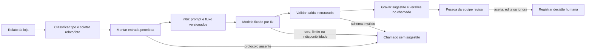

# SEALog — Plano MLOps

Este documento define como planejar o agente de ocorrências do SEALog: um fluxo no n8n usa um modelo de linguagem para sugerir uma ação a partir do relato da loja, das informações da entrega e do protocolo de atendimento. O escopo é operação de um modelo externo; não há treinamento de modelo próprio.

O desenho mantém a sugestão separada da decisão operacional. Uma pessoa avalia o chamado e decide se aceita, altera ou ignora a sugestão.

## 1. Escopo da solução

| Dentro do plano | Fora do plano inicial |
|---|---|
| Classificar e resumir ocorrências para a equipe | Treinar ou fazer fine-tuning de modelo próprio |
| Consultar protocolo aprovado e sugerir uma ação | Decidir, alterar status ou responder sozinho em nome da SEALog |
| Criar um chamado para análise humana | Reembolso, devolução ou outra ação operacional autônoma |
| Versionar prompt, fluxo, modelo e conjunto de avaliação | Feature store, registry de pesos ou treino contínuo |
| Medir resultados por casos de referência e decisões humanas | Troca automática de modelo ou detector complexo de drift |

Sem protocolo aprovado (`Q-SL-05`), o modelo não deve produzir uma recomendação de negócio. O fluxo permanece sem sugestão e o chamado segue pelo tratamento humano existente.

## 2. Fluxo do agente

O único recurso que o agente pode acionar é abrir um chamado por API. O servidor valida credencial, campos e permissões. A API não aceita do agente uma decisão final, mudança de status ou ação sobre a entrega.

## 3. Modelo, prompt e fluxo

### Escolha do modelo

O projeto original propõe GPT-4o. A OpenAI lista os snapshots `gpt-4o-2024-08-06` e `gpt-4o-2024-11-20` para retirada em 14/01/2027 e recomenda `gpt-6-luna` como substituto. Como o agente precisa processar relato e fotos com custo controlado, o plano usa `gpt-6-luna` como candidato inicial para avaliação, sujeito a aprovação pelos casos do domínio. O modelo e o snapshot exatos ficam fixados por versão; atualizar a família exige nova avaliação. [OpenAI — deprecations](https://developers.openai.com/api/docs/deprecations), [GPT-6 Luna](https://developers.openai.com/api/docs/models/gpt-6-luna)

### Versionamento

- Prompt de sistema, instruções do protocolo e configuração do modelo ficam em arquivos versionados no Git.
- Export do fluxo n8n também fica versionado e passa por revisão; editar somente na interface não constitui uma mudança reproduzível.
- Cada resultado de avaliação e sugestão registra o SHA do prompt, o ID do modelo e a versão do fluxo.
- Não versionar segredos, dados reais de chamados nem execuções exportadas. O JSON do n8n pode incluir referências e nomes de credenciais, então deve ser limpo antes de entrar no Git. [n8n — export and import](https://docs.n8n.io/build/manage-workflows/export-and-import/)

## 4. Dados e privacidade

### Contrato de entrada

Enviar somente os elementos definidos para a tarefa:

| Campo | Uso |
|---|---|
| Código da entrega | Relacionar a sugestão ao registro correto |
| Tipo de ocorrência | Guiar a análise e a avaliação |
| Relato integral | Preservar o contexto informado pela loja |
| Foto relacionada | Ajudar a avaliar avaria ou evidência, quando existir |
| Texto do protocolo aprovado | Limitar a sugestão às regras da SEALog |

Nome, telefone e endereço do destinatário não são campos da requisição. O payload é montado por lista fechada; não se envia o registro completo da entrega. O relato integral e a imagem ainda podem conter dados pessoais no próprio conteúdo, então esse risco precisa ser considerado na regra de entrada, acesso às imagens e política de retenção (`Q-SL-16`). Não afirmar anonimização se ela não foi aplicada.

### Tratamento do provedor

Dados enviados à API da OpenAI não são usados para treinamento por padrão, mas logs de monitoramento de abuso podem conter conteúdo e ser mantidos por até 30 dias. Zero Data Retention e Modified Abuse Monitoring dependem de elegibilidade, aprovação e limitações por endpoint. O plano considera a retenção padrão até haver confirmação de controles diferentes e seleciona o endpoint/configuração sem estado persistido quando aplicável. [OpenAI — data controls](https://developers.openai.com/api/docs/guides/your-data)

## 5. Avaliação e qualidade

### Conjunto de referência

Manter no Git casos sintéticos de atraso, não entregue, avaria, endereço errado, recebedor não autorizado, sem retorno e outros, além do buquê de sábado e do registro incorreto. Cada caso contém a entrada permitida, a ação prevista no protocolo aprovado e a justificativa/referência de negócio. Casos reais só podem ser incorporados após remoção/minimização de dados pessoais e aprovação da política de uso.

Esse conjunto inicial cobre categorias mínimas, não representa toda a distribuição de chamados e não deve ser apresentado como medida de desempenho geral. Crescer com exemplos típicos, limites, ambiguidades e tentativas de instrução maliciosa. A OpenAI recomenda conjuntos representativos e avaliação contínua a cada alteração de prompt/modelo; a [OWASP](https://genai.owasp.org/glossary/prompt-injection/) destaca prompt injection e agência excessiva como riscos centrais.

### Critérios de avaliação

| Dimensão | Critério planejado |
|---|---|
| Aderência ao protocolo | A sugestão coincide com a ação esperada nos casos de referência |
| Segurança da ação | Não sugere ação fora do protocolo e não tenta executar uma decisão |
| Privacidade | Não usa os campos de nome, telefone ou endereço como entrada explícita |
| Robustez | Entrada ambígua, incompleta ou com instruções embutidas não amplia as permissões do agente |
| Formato | Saída estruturada válida, com tipo, justificativa curta e ação sugerida |
| Falha | Protocolo ausente, erro de API, teto ou saída inválida resultam em chamado sem sugestão |

Antes de liberar uma versão, executar todos os casos obrigatórios e revisar as divergências. A porta inicial exige todos os casos definidos para o protocolo aprovados; o resultado é válido apenas para aquela amostra, versão de prompt e modelo. Depois, ampliar o conjunto com a revisão dos resultados humanos.

Não usar a plataforma OpenAI Evals como registro permanente: ela fica somente leitura em 31/10/2026 e está prevista para encerrar em 30/11/2026. Armazenar dados e resultados no Git e executar um avaliador controlado pela aplicação/pipeline. [OpenAI — Evals](https://developers.openai.com/api/docs/guides/evals), [depreciações](https://developers.openai.com/api/docs/deprecations)

## 6. Segurança e supervisão humana

- Tratar relatos, fotos, planilhas e texto recuperado como conteúdo não confiável; não obedecer instruções que apareçam dentro desses dados.
- Limitar o agente a uma ferramenta: abrir chamado. Negar ferramentas e credenciais não necessárias.
- Validar a resposta pelo schema e pelas regras no servidor antes de registrar.
- Mostrar de forma visível que a saída é sugestão; apresentar controles de aceitar, editar e ignorar.
- Registrar a decisão humana, quem a tomou, quando e se aceitou, alterou ou ignorou a sugestão.
- Erro do modelo não bloqueia o fluxo de ocorrências: o chamado continua disponível sem sugestão.

O NIST AI RMF para IA generativa organiza a gestão em governar, mapear, medir e gerenciar riscos; neste projeto isso se traduz em delimitar finalidade, dados, permissões, avaliação e tratamento de falhas. [NIST AI RMF — Generative AI Profile](https://nvlpubs.nist.gov/nistpubs/ai/NIST.AI.600-1.pdf)

## 7. Operação do modelo e custos

Manter uma configuração única de produção, sem roteamento automático entre modelos. Mudança de modelo é tratada como nova versão: comparar com a anterior no mesmo conjunto, analisar casos divergentes e atualizar o ID versionado somente após a avaliação.

O limite de planejamento do projeto para chamadas ao modelo é cerca de R$ 120 por mês, com aviso ao atingir 80%. Configurar limite de gasto no projeto da API e complementar com controle de consumo na aplicação. A documentação da OpenAI esclarece que hard limits podem não ser aplicados instantaneamente e podem exceder um pouco o valor contabilizado; por isso, não tratar o limite do provedor isoladamente como teto exato em reais. [OpenAI — project spend limits](https://help.openai.com/en/articles/9186755-managing-projects-in-the-api-platform)

Medir apenas o necessário para entender custo e qualidade: chamadas concluídas/falhas, tokens/custo por período, latência, modelo/prompt/fluxo e desfecho humano. Não registrar corpo do relato, imagem, segredo ou resposta integral em telemetria geral. Revisão humana dos desfechos é suficiente no início; automação de drift e quadro analítico ficam para quando volume e estabilidade do conjunto justificarem.

## 8. Decisões de planejamento

| Decisão | Justificativa | Efeito |
|---|---|---|
| Sem treinamento de modelo próprio | O sistema propõe um assistente de atendimento com regras e contexto, sem dados rotulados em volume para treinar | O esforço fica em protocolo, prompt, testes e supervisão |
| Sugestão com decisão humana obrigatória | O agente trata exceções que afetam pedido e cliente; a responsabilidade operacional continua na equipe | Nenhum output do modelo muda status ou destino da entrega sozinho |
| Entrada por lista fechada | Reduz exposição de dados do registro completo | Relato/foto ainda requerem avaliação de conteúdo sensível |
| Prompt, modelo e fluxo versionados em conjunto | Mudanças de modelo e instrução alteram comportamento | Cada release pode ser reproduzida e comparada |
| Avaliação própria em Git/CI | A plataforma Evals está em encerramento e a amostra é específica ao domínio | Casos e resultados ficam independentes de ferramenta externa |
| `gpt-6-luna` como candidato a avaliar | É o substituto recomendado pela OpenAI para GPT-4o e adequado a cargas focadas/custo-sensíveis | Só usar depois de avaliar texto e imagem no conjunto SEALog |
| Sem fallback automático | Modelos diferentes podem produzir comportamento e custo distintos | Indisponibilidade gera atendimento humano sem sugestão |

## Referências

- Contexto do projeto: `docs/00-visao-geral/decisoes.md`, `arquitetura.md`, `requisitos.md`, `infraestrutura-e-custos.md`; `docs/01-sealog/02-regras-de-negocio.md`, `07-integracoes.md`, `09-divergencias-e-lacunas.md`.
- [OpenAI — evaluation best practices](https://developers.openai.com/api/docs/guides/evaluation-best-practices).
- [OpenAI — data controls](https://developers.openai.com/api/docs/guides/your-data).
- [OpenAI — model deprecations](https://developers.openai.com/api/docs/deprecations) e [GPT-6 Luna](https://developers.openai.com/api/docs/models/gpt-6-luna).
- [NIST AI RMF — Generative AI Profile](https://nvlpubs.nist.gov/nistpubs/ai/NIST.AI.600-1.pdf).
- [OWASP GenAI — prompt injection](https://genai.owasp.org/glossary/prompt-injection/) e [excessive agency](https://genai.owasp.org/llmrisk2023-24/llm08-excessive-agency/).
- [n8n — export and import](https://docs.n8n.io/build/manage-workflows/export-and-import/).

Fontes de fornecedor e recomendações técnicas conferidas em 29/10/2026.
